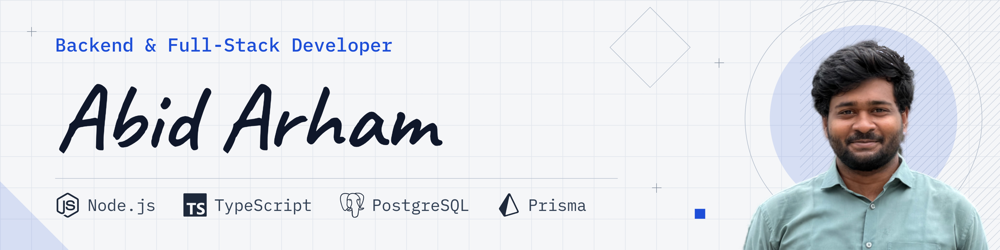
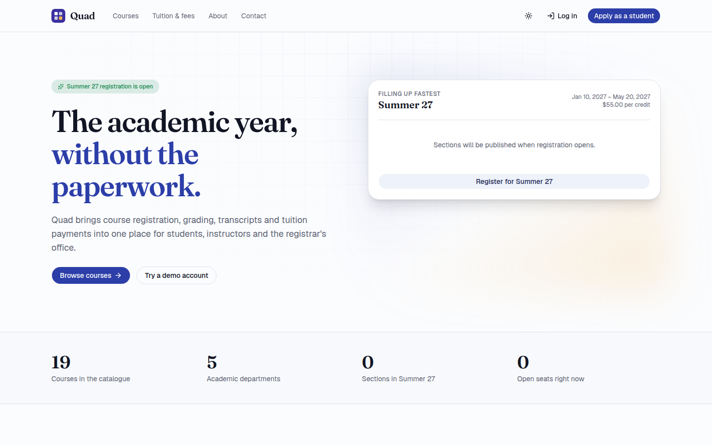
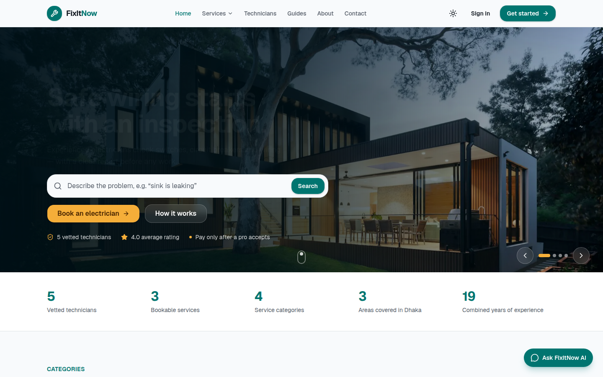
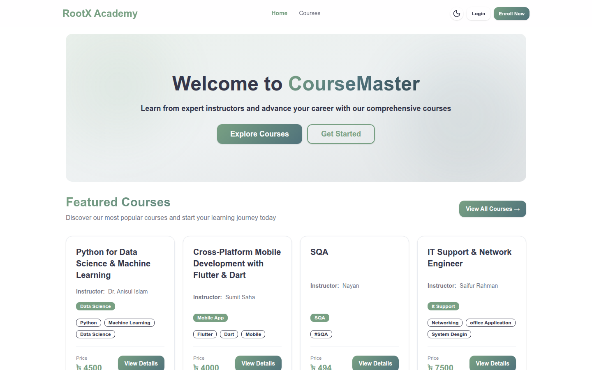
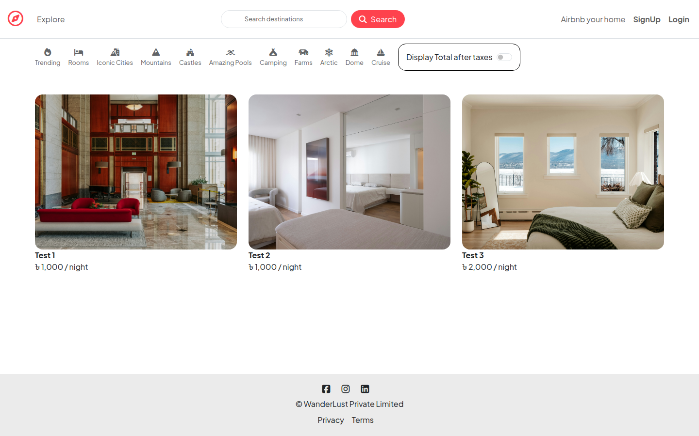

<div align="center">



<p>
  <a href="https://www.linkedin.com/in/abid-arham-111457245" target="_blank">
    
  </a>
  &nbsp;
  <a href="https://github.com/abid-arham" target="_blank">
    
  </a>
  &nbsp;
  <a href="mailto:mix.arham@gmail.com">
    
  </a>
</p>


</div>

---

## `$ whoami`

I'm a **CSE student and junior full-stack developer** with a strong interest in backend engineering.

I enjoy building web applications where I have to think beyond the UI — designing APIs, modeling databases, implementing authentication, handling business logic, and connecting everything into a working system.


---

## 🚀 Current Focus

```text
🔨  Building full-stack web applications
⚙️  Developing backend services with Node.js, Express & TypeScript
🗄️  Designing and working with PostgreSQL, MongoDB & MySQL
🔐  Implementing authentication, authorization & validation
🧩  Designing REST APIs and backend architecture
📚  Strengthening Data Structures & Algorithms
🌱  Learning system design, Prisma & production practices
```

---


## 💼 Looking For

I'm currently looking for opportunities where I can grow as a software engineer while contributing to real products and real engineering problems.

* Backend Development Opportunities
* Junior Full-Stack Developer Roles
* Software Engineering Internships
* Open Source Contributions
* Backend / API-focused Projects
* Collaborative Development Teams

---
## 🔥 Featured Projects

### 🎓 Quad — University Management System

**Next.js 16 · React 19 · TypeScript · Express 5 · PostgreSQL · Prisma · Stripe · Redis**

<a href="https://assignment-7-three-xi.vercel.app/">
  
</a>

**The problem:** University admin is spread across disconnected systems — registration in one place, grades in another, tuition in a third. Students can't see what they owe, instructors re-key grades, and the registrar reconciles by hand.

**What it does:** One platform with three separate role-scoped workspaces. Students register for courses, track GPA, pull transcripts and pay tuition. Instructors grade their own sections and nothing else. The registrar edits the catalogue, manages prerequisite chains and watches a financial dashboard.

**Engineering worth noting:**

* Race-free enrollment using transactional row locks, so a section can't be overbooked under concurrent registration
* Prerequisite chain validation that rejects circular dependencies at write time
* Credit-weighted GPA calculation backing live transcript generation
* Idempotent Stripe webhook handling — a replayed event can't double-charge
* Soft-delete audit logging for every administrative mutation
* Silent token refresh with httpOnly cookie storage; optimistic UI for drops, grade entry and enrollment toggles

<a href="https://assignment-7-three-xi.vercel.app/">→ Live Demo</a> &nbsp;·&nbsp;
<a href="https://github.com/abid-arham/Quad-Fullstack">→ Frontend</a> &nbsp;·&nbsp;
<a href="https://github.com/abid-arham/Quad-Backend">→ Backend API</a>

---

### 🔧 FixItNow — Home Services Marketplace

**Next.js 16 · React 19 · TypeScript · Tailwind CSS 4 · REST API · OAuth · Claude API**

<a href="https://assignment-5-alpha-brown.vercel.app/">
  
</a>

**The problem:** Booking a plumber or electrician means calling around blind — no verified ratings, no visible availability, no way to tell if the person is any good until they show up. And customers don't search by service name, they search by symptom: *"sink is leaking."*

**What it does:** A three-sided marketplace. Customers find and book vetted technicians across plumbing, electrical, cleaning and internet; technicians manage jobs and availability; admins run the platform.

**Engineering worth noting:**

* Three distinct dashboards (customer / technician / admin), each with live charts, filterable paginated tables and editable profiles
* Smart search that resolves plain-language problem descriptions and typos into services
* Personalized recommendations derived from booking and browsing history, each surfaced with its reason
* Admin anomaly detection — stale requests, unpaid acceptances, booking spikes, supply gaps
* Google and Facebook OAuth layered over an email-only API, with deterministic HMAC account linking
* Ratings recomputed from raw review lists rather than trusting stale upstream aggregates
* Full light/dark theming

<a href="https://assignment-5-alpha-brown.vercel.app/">→ Live Demo</a> &nbsp;·&nbsp;
<a href="https://github.com/abid-arham/FixItNow">→ View Repository</a>

> Demo accounts — customer `customer@fixitnow.test` · technician `alice.tech@fixitnow.test` · admin `admin@fixitnow.test`

---

### 📚 CourseMaster — E-Learning Platform

**React 19 · Vite · Redux Toolkit · Tailwind + DaisyUI · Node.js · Express 5 · MongoDB · Mongoose · JWT · Zod**

<a href="https://course-master4981.netlify.app/">
  
</a>

**The problem:** Small course creators end up stitching together a video host, a payment link and a spreadsheet to track who finished what. There's no single place that handles enrollment, progress, assignments and grading together.

**What it does:** A full e-learning platform. Students browse and filter a course catalogue, enroll, work through video lessons, submit assignments and take quizzes with instant scoring. Admins build courses with nested syllabus/lesson structures, run batches, grade submissions and read enrollment analytics.

**Engineering worth noting:**

* Nested document modelling — course → syllabus section → lesson → quiz — in a single Mongo document
* Per-lesson progress tracking with a derived completion percentage
* Compound unique index on `{student, course}` to make double-enrollment impossible at the database level
* Role-gated admin routes behind JWT middleware, plus an optional registration-key path for admin creation
* Zod request validation and bcrypt password hashing throughout
* Analytics endpoint: 30-day enrollment trend, top courses, platform-wide totals
* Non-blocking welcome emails via Nodemailer — a mail failure never fails a registration
* A regression suite covering auth, authorization, enrollment, quizzes, admin CRUD, ban enforcement and cascade delete

<a href="https://course-master4981.netlify.app/">→ Live Demo</a> &nbsp;·&nbsp;
<a href="https://github.com/abid-arham/courseMaster_frontEnd_fixed">→ Frontend</a> &nbsp;·&nbsp;
<a href="https://github.com/abid-arham/courseMaster_Backend_fixed">→ Backend API</a>

---

### 🛒 NextCart — Multi-Vendor E-Commerce

**Core PHP · MySQL · MVC · Raw mysqli**

**The problem:** Most e-commerce tutorials build a single-seller store. A real marketplace has to keep four parties — customer, seller, courier, admin — working against the same order without letting any of them see each other's data.

**What it does:** A multi-vendor marketplace with four separate portals. Customers shop, manage a cart, wishlist and saved addresses, and file returns. Sellers run their own inventory and coupons. Delivery agents handle zones and dispatch. Admins govern categories, users, announcements and disputes.

**Engineering worth noting:**

* Built on core PHP with no framework — routing, MVC structure, sessions and auth written by hand
* Raw `mysqli` queries throughout, so every join and transaction is explicit
* Four role-partitioned portals sharing one schema
* Full order lifecycle: cart → checkout → dispatch → delivery → returns and dispute resolution
* No build step — drops straight onto any XAMPP/LAMP/WAMP server

<a href="https://github.com/abid-arham/Project-NextCart">→ View Repository</a>

---

### ⚡ DevPulse — Internal Issue & Feature Tracker

**Node.js 24 · TypeScript · Express · PostgreSQL · Raw SQL · JWT · bcrypt**

**The problem:** Small teams outgrow a shared channel for bug reports but aren't ready for a heavyweight tracker. They need something where a contributor can file and fix their own issues without being able to touch anyone else's.

**What it does:** A REST API for reporting bugs and feature requests, with a two-role permission model and a status workflow (`open → in_progress → resolved`).

**Engineering worth noting:**

* Deliberately ORM-free — raw SQL against the native `pg` driver, to learn what an ORM actually abstracts away
* Ownership-scoped authorization: contributors may edit only their own open issues; maintainers have full access
* JWT auth with bcrypt hashing, enforced by typed Express middleware
* Filtering and sorting handled in SQL rather than in application memory

<a href="https://github.com/abid-arham/devpulse">→ View Repository</a>

---

### 🏡 Wanderlust — Travel Listing Marketplace

**Node.js · Express · MongoDB · Mongoose · EJS · Passport · Cloudinary · Mapbox**

<a href="https://wanderlust-oa2t.onrender.com/listings">
  
</a>

**The problem:** A classic marketplace exercise — let anyone list a property, but make sure only the owner can edit it, only real users can review it, and every listing lands on a map.

**What it does:** An Airbnb-style listing platform with authentication, owner-scoped CRUD, reviews, image uploads and geocoded map placement.

**Engineering worth noting:**

* Passport-based sessions with owner-only authorization middleware on every mutating route
* Cloudinary-hosted image uploads instead of local disk, so the app stays stateless
* Mapbox geocoding — addresses resolved to coordinates on save, then rendered as map pins
* Server-side rendering with EJS layouts and partials
* Category filtering across trending, rooms, iconic cities, mountains, castles and more

<a href="https://wanderlust-oa2t.onrender.com/listings">→ Live Demo</a> &nbsp;·&nbsp;
<a href="https://github.com/abid-arham/Wanderlust">→ View Repository</a>


---

## 🛠 Tech Stack

### Languages

<div align="left">


</div>

---

### Frontend

<div align="left">


</div>

---

### Backend

<div align="left">


<br/>


</div>

---

### Databases

<div align="left">


</div>

---

### Tools

<div align="left">


</div>

---


## 📫 `$ ./contact.sh`

<div align="center">

<a href="https://www.linkedin.com/in/abid-arham-111457245" target="_blank">

</a>

 

<a href="mailto:mix.arham@gmail.com">

</a>

 

<a href="https://github.com/abid-arham" target="_blank">

</a>

<br/><br/>


<br/><br/>


</div>
